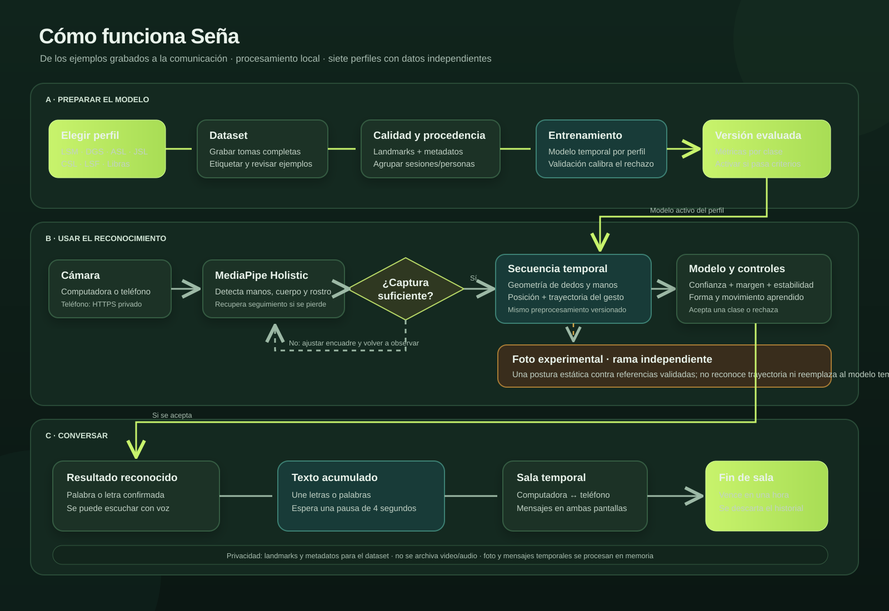

# Seña

Seña es una aplicación web local para recopilar ejemplos de la **Lengua de Señas Mexicana (LSM)**, entrenar un modelo con esos ejemplos y reconocer las clases aprendidas. La interfaz y el texto de salida están en español. Los perfiles de otras lenguas fueron retirados de la aplicación; sus archivos históricos se conservan en disco, pero la aplicación actual no los carga ni los muestra.

El sistema no incluye un diccionario universal ni modelos preentrenados de todas las señas. Una palabra o letra solo se puede reconocer cuando tiene ejemplos correctos, fue incluida en un entrenamiento y el modelo activo la aprendió.

## Mapa visual del proyecto



El diagrama muestra cómo se conectan las partes principales. Este README también incluye la [referencia de funciones](#referencia-función-por-función) para consultar el propósito de cada función y método.

## Abrir Seña en Windows

**La primera vez**, instala Python 3.11 de 64 bits y abre PowerShell en la carpeta `LSM`, donde está `web_app.py`. Ejecuta estos comandos uno por uno para crear el entorno e instalar las dependencias.

```powershell
py -3.11 -m venv .venv
.\.venv\Scripts\python.exe -m pip install -r requirements.txt
```

**Cada vez que quieras abrir Seña**, ejecuta este comando desde la misma carpeta.

```powershell
.\.venv\Scripts\python.exe web_app.py
```

El navegador se abre automáticamente. También puedes entrar desde esa computadora en [http://127.0.0.1:8765](http://127.0.0.1:8765). Deja PowerShell abierto mientras usas Seña. Para detener el servidor, presiona **Ctrl+C** en esa ventana.

## Preparar Python en macOS o Linux

El repositorio usa Python 3.11. Si la carpeta `.venv/` no está disponible, desde la raíz ejecuta:

```bash
python3.11 -m venv .venv
.venv/bin/python -m pip install --upgrade pip
.venv/bin/python -m pip install -r requirements.txt
```

En la computadora del proyecto normalmente ya existe ese entorno; en ese caso basta con usar `.venv/bin/python web_app.py`. No instales paquetes con otro Python si vas a ejecutar la aplicación con `.venv`.

## Avisos de MediaPipe en otra computadora

`Feedback manager requires a model with a single signature inference. Disabling support for feedback tensors.` es una **advertencia interna de MediaPipe**, no un error de entrenamiento de Seña. MediaPipe continúa sin esa función opcional. Puede aparecer varias veces porque Holistic usa varios modelos y Seña crea detectores auxiliares cuando necesita recuperar las manos. Ese mensaje por sí solo no demuestra que la cámara o el reconocimiento hayan fallado.

Para comprobar la instalación sin abrir la cámara ni modificar datos, ejecuta en Windows:

```powershell
.\.venv\Scripts\python.exe diagnostico_mediapipe.py
```

En macOS/Linux:

```bash
.venv/bin/python diagnostico_mediapipe.py
```

La prueba informa el Python y las versiones instaladas, y procesa tres imágenes vacías con cada configuración de detector utilizada por la app. Si termina con `Detectores operativos`, esos avisos no impidieron procesar las imágenes. Esto no comprueba permisos de cámara ni el modelo entrenado de Seña. Si aparece `ERROR`, comparte la salida completa, especialmente el `Traceback`; no basta con las líneas que empiezan por `W0000`.

Usa el entorno de Python 3.11 creado **en esa computadora** con `requirements.txt`; no copies `.venv` desde otra máquina. Si faltan paquetes, instálalos con el mismo ejecutable de Python que usas para iniciar Seña. No se ocultan los errores nativos ni se cambian los umbrales de reconocimiento para eliminar este aviso.

## Compatibilidad y grabaciones en equipos diferentes

El rig dibuja únicamente puntos sobre el video vivo; no coloca una captura fija encima. Los puntos desaparecen después de 300 ms sin actualización y el estado cambia a «Esperando nueva detección…». Esto indica una demora del procesamiento, no necesariamente que la cámara se haya desconectado. Durante el uso de cámara se suspenden las consultas automáticas del inventario; las actualizaciones solicitadas al guardar o terminar una tanda se conservan.

La aplicación web usa la cámara del navegador y un servidor Python local. El entorno de referencia es **Python 3.11 de 64 bits** en macOS (Intel/Apple Silicon), Windows x86-64 y Linux x86-64. Esto no garantiza soporte para cualquier arquitectura o versión de sistema: MediaPipe 0.10.14 y TensorFlow deben disponer de paquetes compatibles. Windows ARM y otros equipos requieren una comprobación específica antes de considerarlos compatibles. Crea `.venv` en cada computadora; nunca copies el entorno virtual entre sistemas.

`requirements.txt` instala una sola distribución de OpenCV: `opencv-contrib-python`, que también necesita MediaPipe. Si tu entorno ya tiene `opencv-python` y `opencv-contrib-python` instalados simultáneamente, detén Seña y corrígelo con el Python del entorno. En Windows:

```powershell
.\.venv\Scripts\python.exe -m pip uninstall -y opencv-python opencv-contrib-python
.\.venv\Scripts\python.exe -m pip install -r requirements.txt
.\.venv\Scripts\python.exe web_app.py
```

En macOS/Linux usa `.venv/bin/python` en los mismos comandos. Después recarga la página para cargar el JavaScript actualizado. Los datasets y modelos no se eliminan con estos comandos.

La comprobación de pausas excluye el tiempo de procesamiento local completo. Si hay una interrupción real de más de un segundo entre solicitudes, se descarta la toma parcial y se detiene la tanda, pero el visor permanece abierto y permite repetir la toma. No se rellenan fotogramas ni se guardan secuencias incompletas. Cambiar de pestaña u ocultar la página sigue deteniendo la cámara por privacidad.

El flujo `.github/workflows/compatibility.yml` ejecuta pruebas de tiempos, conexión, confirmaciones y procesos en Windows, macOS y Linux después de subir cambios a GitHub. Estas pruebas no sustituyen la prueba física de cámara y precisión en cada equipo; revisa el resultado de Actions antes de dar por validada una plataforma.

## Empezar a usar Seña

### 1. Iniciar el servidor

Abre Terminal y ejecuta este comando desde cualquier carpeta (ajusta la ruta si moviste el proyecto):

```bash
cd "/Users/apple/Documents/python_work/lia projects/LSM" && .venv/bin/python web_app.py
```

El comando inicia el servidor, imprime la URL `http://127.0.0.1:8765` en Terminal y abre esa dirección en el navegador. En modo local no hace falta iniciar sesión manualmente. Deja el programa abierto mientras usas la página; para detenerlo, vuelve a Terminal y presiona **Ctrl+C**. Para iniciar sin abrir el navegador automáticamente, añade `--no-open`.

### Abrir Seña temporalmente sin Tailscale

Para que personas fuera de tu red puedan entrar y usar la cámara del teléfono, instala `cloudflared` una vez en la Mac:

```bash
brew install cloudflared
```

Después inicia el programa con un solo comando:

```bash
cd "/Users/apple/Documents/python_work/lia projects/LSM" && .venv/bin/python web_app.py --quick-tunnel
```

Seña creará una dirección HTTPS temporal, la imprimirá en Terminal y la abrirá en el navegador. Comparte esa misma dirección con el equipo. La cámara del teléfono y los enlaces QR de **Conversación** usarán automáticamente ese origen HTTPS. El público puede abrir Inicio, Probar modelo y Configuración sin cuenta. Para abrir Dataset y Entrenamiento, pulsa **Admin** en la esquina inferior derecha e introduce la contraseña administrativa. En Render, configura `SENA_ADMIN_PASSWORD` en **Environment** con la contraseña acordada. En local se usa el archivo privado `web_data/admin/auth.json` si esa variable no está configurada.

El enlace es accesible por quien lo conozca y el tráfico pasa por Cloudflare. Úsalo solo para pruebas o colaboración temporal y compártelo con cuidado. La dirección deja de funcionar al cerrar la Terminal con **Ctrl+C**; al volver a iniciar puede ser distinta. No hace falta iniciar Tailscale.

También puedes ejecutar `cloudflared tunnel --url http://127.0.0.1:8765` en otra Terminal y configurar manualmente `--public-url` y `--phone-origin`, pero `--quick-tunnel` automatiza esos pasos.

Si el puerto 8765 ya está ocupado, normalmente significa que Seña ya está ejecutándose. Usa la página abierta o detén la instancia anterior desde la Terminal que la inició antes de abrir otra. No cierres un proceso que no hayas identificado como `web_app.py`.

Para escoger otro puerto:

```bash
.venv/bin/python web_app.py --port 8877
```

Después abre <http://127.0.0.1:8877>.

### 2. Elegir cámara y preparar el encuadre

1. Abre **Configuración → Cámara y captura** y pulsa **Detectar cámaras**.
2. Elige la cámara que vas a utilizar y concede permiso cuando el navegador lo pida.
3. Activa **Rig de manos** si quieres ver temporalmente los puntos y conexiones de las manos detectadas. También se puede activar desde la esquina superior derecha del video.
4. Coloca las manos dentro del encuadre, con buena luz y sin tapar los dedos. La vista se muestra en espejo.

El rig es una ayuda visual. No modifica el modelo ni hace que una seña no entrenada se pueda reconocer.

### 3. Grabar ejemplos para una letra o palabra

1. Entra en **Dataset** y selecciona la clase que quieras grabar. Para añadir una palabra nueva, escribe su nombre y guárdala en el vocabulario.
2. Activa la cámara y espera a que aparezca el aviso de encuadre listo.
3. Pulsa **Grabar una seña**. Cuando empiece la captura, realiza la seña completa. Para una seña con movimiento, muestra el recorrido entero desde la posición inicial hasta la final.
4. Al terminar, nombra y guarda la toma. Una toma sin nombre queda en **Grabaciones pendientes** hasta guardarla o descartarla.
5. Repite la grabación variando un poco la distancia, posición, velocidad, iluminación y persona. No grabes todos los ejemplos como copias idénticas.

Puedes grabar tandas consecutivas de **5 a 60 tomas**. El contador muestra cuántas tomas completas llevas. Para entrenar se exigen **30 ejemplos completos por clase** y al menos dos clases. Se recomiendan 30–60 ejemplos variados por letra o palabra. Añadir una letra al abecedario crea su etiqueta vacía, no ejemplos: cada letra también se debe grabar.

Las secuencias guardadas contienen puntos (landmarks) y metadatos de captura, no archivos de video o audio. Revisa el vocabulario y borra o corrige ejemplos incorrectos antes de entrenar.

### 4. Entrenar el modelo

1. Abre **Entrenamiento**.
2. Selecciona las clases que quieres entrenar. Incluye las clases anteriores que quieras conservar; las clases aprendidas con datos guardados se mantienen en el entrenamiento.
3. Escoge la cantidad de épocas y, si corresponde, la estrategia. La opción de referencia es el punto de partida; `discriminative`, `contrastive`, `trajectory` y `robust` son alternativas que se deben comparar con métricas.
4. Pulsa **Entrenar modelo** y deja la página abierta mientras se muestra el progreso.
5. Revisa las gráficas, la matriz de confusión, las métricas por clase y el estado de activación. Seña activa la versión cuando el entrenamiento termina y guarda el modelo completo. Al arrancar, selecciona la versión compatible más reciente.

El reparto de ejemplos procura mantener sesiones y participantes completos en un solo conjunto. La validación ajusta la decisión del modelo; la prueba reservada sirve para evaluar y no debe usarse para escoger épocas o umbrales. Si los datos no tienen procedencia suficiente, la interfaz debe advertir que la evaluación es exploratoria.

### 5. Probar el modelo

1. Ve a **Reconocimiento** y confirma que el perfil activo sea **LSM · Español**.
2. Selecciona **Probar modelo**, activa la cámara y realiza una seña que aparezca entre las clases aprendidas por el modelo.
3. Mantén el gesto el tiempo suficiente para que el sistema acumule ventanas estables. En modo de prueba, una puntuación de 90% o más puede satisfacer el umbral de confianza, pero todavía debe pasar estabilidad, forma, movimiento y ambigüedad. Una puntuación alta no garantiza que la respuesta sea correcta.
4. Si el sistema rechaza la seña, repite el gesto con el recorrido completo o revisa los ejemplos y la matriz de confusión. No se debe añadir una regla manual para forzar una letra determinada.

La voz se reproduce automáticamente al confirmar una etiqueta si el navegador ofrece síntesis de voz. **Escuchar** permite repetirla manualmente. La disponibilidad y el acento dependen de las voces instaladas en el sistema.

### 6. Foto experimental

La opción **Foto experimental** compara una sola imagen de la postura con referencias geométricas. Solo puede aceptar clases con suficiente evidencia de validación. No reconoce trayectoria ni gramática y no reemplaza el clasificador temporal; úsala para explorar posturas estáticas, no señas que requieren movimiento. La imagen se procesa en memoria. Consulta [docs/FOTO_EXPERIMENTAL.md](docs/FOTO_EXPERIMENTAL.md).

### 7. Conversar con un teléfono

La conversación permite que una persona use la computadora y otra el teléfono para enviar texto o señas reconocidas. En la misma computadora puedes usar la dirección local. Para un teléfono sin Tailscale, inicia Seña con `--quick-tunnel`; el sitio HTTPS que aparece en Terminal habilita la cámara móvil.

1. Con el servidor abierto, entra en **Conversación** y crea una sala.
2. Comparte el QR o enlace temporal con la otra persona. Si el teléfono no está en la misma red, ambos deben entrar por la dirección HTTPS temporal de Cloudflare.
3. En el teléfono, acepta el uso de cámara, pulsa **Activar cámara** y permite el acceso del navegador.

Las letras reconocidas se acumulan y se envían tras cuatro segundos sin una seña confirmada nueva. La sala vence en una hora. Los mensajes permanecen en memoria y se descartan al cerrar o vencer la sala. No se guardan el video ni el audio. El enlace temporal es público para quien lo reciba y transporta el tráfico a través de Cloudflare. Más detalles: [docs/CAMARA_TELEFONO.md](docs/CAMARA_TELEFONO.md).

## Glosario para leer el proyecto

- **Perfil LSM:** selección del sistema de señas que se está usando. Actualmente solo existe el perfil LSM, con texto de salida en español.
- **Clase / etiqueta:** nombre de una letra o palabra del vocabulario, por ejemplo `hola`. El nombre identifica el resultado esperado; no contiene por sí mismo el gesto.
- **Toma / secuencia:** un ejemplo grabado de un gesto, formado por cuadros consecutivos de puntos detectados.
- **Landmark:** coordenada de un punto detectado en mano, rostro o cuerpo. La toma guardada contiene estos valores, no la imagen original.
- **Dataset:** conjunto de tomas etiquetadas que se usa para entrenar y evaluar.
- **Época:** una pasada de entrenamiento sobre ejemplos de entrenamiento. Más épocas no aseguran más precisión.
- **Entrenamiento / validación / prueba:** datos usados para ajustar pesos / calibrar decisiones / estimar el resultado final. No reutilices la prueba para ajustar el modelo.
- **Confianza:** puntuación de salida para una predicción. No es lo mismo que accuracy y no garantiza que la respuesta sea correcta.
- **Versión activa:** bundle que carga la app para inferencia. Incluye pesos, etiquetas, metadatos y política de decisión compatibles.
- **Pipeline:** secuencia exacta de detección y transformaciones de características. Debe coincidir entre captura, entrenamiento e inferencia.

## Cómo está organizado el repositorio

```text
LSM/
├── README.md                    Guía, mapa de archivos y referencia de funciones
├── .gitignore                   Archivos locales que Git debe omitir
├── .venv/                       Entorno virtual local de Python (no se comparte)
├── web_app.py                   Servidor web local y coordinador de la aplicación
├── sign_languages.py            Perfil LSM, etiquetas, rutas y límites del dataset
├── config.py                    Parámetros compartidos y rutas raíz
├── alphabets.py                 Catálogo del abecedario español
├── web_dataset.py               Lectura y escritura de tomas y ejemplos
├── dataset_tools.py             Auditoría, deduplicación, importación y exportación
├── validation_protocol.py       Reparto persistente por sesión/persona
├── capture_quality.py           Control de calidad de imagen, manos y secuencias
├── recognition_features.py      Características y preprocesamiento versionado
├── motion_features.py           Trayectorias y movimiento de señas
├── recognition_decision.py      Reglas calibradas de aceptación y rechazo
├── recognition_analysis.py      Métricas, confusiones y comparación de modelos
├── snapshot_recognition.py      Comparación experimental de una sola imagen
├── model.py                     Arquitecturas de red neuronal
├── web_train.py                 Entrenamiento utilizado por la aplicación web
├── discriminative_learning.py   Muestreo difícil y aprendizaje contrastivo
├── studio_services.py           Versiones, actividad y cambios administrativos
├── admin_auth.py                Verificación de contraseña administrativa
├── accounts.py / team_access.py Componentes del modo de equipo heredado
├── private_server.py            Configuración antigua del proxy Tailscale
├── main.py / train.py           Aplicación y entrenamiento de escritorio heredados
├── data_collection.py           Captura de escritorio heredada
├── utils.py / rig_overlay.py    Utilidades heredadas de escritorio y rig
├── static/                      Interfaz del navegador y recursos estáticos
├── models/                      Versiones de modelos y metadatos
├── web_data/                    Dataset, vocabulario, trabajos y datos locales
├── LSM_Dataset/                 Dataset para el flujo antiguo de escritorio
├── sesiones/                    Salidas de sesión del flujo antiguo de escritorio
├── assets/                      Recursos gráficos del flujo de escritorio
├── deploy/                      Ejemplos y comandos del despliegue privado antiguo
├── docs/                        Guías, auditorías y decisiones técnicas
├── tests/                       Pruebas Python y JavaScript
├── requirements.txt             Dependencias de Python
└── .python-version              Versión de Python prevista por el proyecto
```

### Carpetas que contienen datos

- `web_data/datasets/lsm/`: secuencias de entrenamiento guardadas, agrupadas por etiqueta.
- `web_data/drafts/lsm/`: tomas capturadas que todavía no se nombraron o integraron.
- `web_data/vocabulary/`: nombres personalizados de las señas en formato JSON.
- `web_data/trash/`: ejemplos borrados recuperables y su recibo de operación.
- `web_data/jobs/`: estado y progreso persistente de entrenamientos.
- `web_data/admin/`: credenciales administrativas protegidas; no las publiques ni las subas al repositorio.
- `models/lsm/`: versiones del modelo, archivos `model.keras`, metadatos, políticas de aceptación y manifiesto `current.json`.
- `models/lsm/evaluation_split.json`: reserva estable que impide reciclar ejemplos de prueba como entrenamiento al ampliar clases.
- `LSM_Dataset/` y `models/lsm_model.h5`: archivos del flujo de escritorio anterior; la aplicación web usa el bundle de `models/lsm/`.

Hay carpetas históricas de otros perfiles bajo `web_data/` o `models/`. Se conservan, pero el perfil activo LSM no las lee. No las borres si necesitas conservar esos datos.

Para respaldar el trabajo, detén el servidor y copia `web_data/datasets/lsm/`, `web_data/vocabulary/`, `web_data/trash/`, `models/lsm/` y `models/lsm/evaluation_split.json` a un lugar seguro. Trata los puntos de movimiento como datos privados aunque no sean video.

### Compartir las grabaciones mediante GitHub

Las tomas confirmadas de LSM y su vocabulario ya están permitidos en `.gitignore`.
Son archivos de puntos `.npz`, con metadatos de captura; Seña no guarda videos ni audio.
En GitHub Desktop, selecciona los cambios de `web_data/datasets/lsm/` y
`web_data/vocabulary/lsm.json`, crea el commit y pulsa **Push origin**.
Las nuevas tomas guardadas aparecerán también en los cambios pendientes.

Desde la terminal puedes añadirlas al próximo commit con:

```bash
git add -- web_data/datasets/lsm/ web_data/vocabulary/lsm.json
```

Un commit es local: las grabaciones llegan a GitHub cuando haces push. Quienes
tengan acceso al repositorio podrán descargarlas, incluidos sus metadatos de
sesión y participante. Borradores, credenciales, cuentas, papelera y modelos
continúan excluidos. Después de descargar los datos en otro equipo, entrena allí
el modelo; los pesos del modelo no forman parte de este respaldo.

## Recorrido interno: qué llama a qué

1. El navegador carga `static/index.html` y `static/styles.css`.
2. Los controladores `static/app.js`, `static/studio.js` y los demás scripts manejan botones, cámara, formularios y navegación.
3. Los scripts envían peticiones JSON al servidor estándar de Python en `web_app.py`.
4. El `Handler` comprueba la petición y llama a funciones de dataset, calidad, reconocimiento, conversación o entrenamiento.
5. `sign_languages.py` valida que las operaciones usen el perfil activo LSM y encuentra las rutas de datos/modelos.
6. `web_dataset.py` lee y guarda secuencias NPZ. `dataset_tools.py` inspecciona su integridad y procedencia.
7. `recognition_features.py` convierte landmarks crudos a características. La versión se guarda en los metadatos del modelo para que el entrenamiento y la inferencia usen el mismo proceso.
8. `web_train.py` prepara particiones, construye la red de `model.py`, entrena y evalúa. Publica una versión solo si cumple las reglas de activación.
9. En inferencia, `web_app.py` pasa la secuencia por el modelo y `recognition_decision.py` decide aceptar o rechazar.
10. La interfaz muestra la etiqueta y opcionalmente la lee en voz alta. En conversación, el servidor la añade al borrador temporal de esa sala.

Las funciones y métodos individuales están explicados más abajo y junto a su definición en el código.

## Vistas de la página

| Vista | Para qué sirve |
|---|---|
| **Inicio** | Ver conteos actuales, actividad y estado del modelo LSM. |
| **Reconocimiento** | Usar la cámara para probar el modelo, revisar la etiqueta/confianza y escuchar la salida. |
| **Conversación** | Abrir una sala temporal con otra persona y conectar un teléfono. |
| **Dataset** | Grabar, nombrar, revisar, importar/exportar y administrar ejemplos. |
| **Entrenamiento** | Seleccionar clases, iniciar trabajo, revisar curvas y confusiones y gestionar versiones. |
| **Configuración** | Seleccionar cámara, cambiar apariencia, activar el rig y revisar preferencias de captura. |

## Grupos de rutas HTTP

El frontend no escribe los datos directamente. Envía JSON a `web_app.py`, que comprueba la sesión y el tipo de operación antes de llamar al módulo correspondiente.

| Ruta o grupo | Acción |
|---|---|
| `GET /` y `GET /static/*` | Sirve la página, scripts, estilos, tipografía e iconos locales. |
| `GET /api/auth/status` y `GET /api/state` | Consulta el acceso local/equipo y obtiene el estado del perfil, etiquetas, datos y modelo. |
| `POST /api/session`, `/api/frame`, `/api/snapshot`, `/api/reset`, `/api/close` | Crea/cierra una sesión de cámara, procesa cuadros, compara foto experimental o reinicia el buffer. |
| `POST /api/capture`, `/api/capture/save`, `/api/capture/discard` | Inicia tomas individuales/consecutivas y guarda o descarta las tomas pendientes. |
| `POST /api/alphabet` | Añade etiquetas vacías del abecedario español al vocabulario. No genera muestras. |
| `POST /api/dataset/*` | Audita muestras, revisa una toma, importa/exporta ZIP y aplica cambios administrativos. |
| `POST /api/train`, `POST /api/models/list` | Inicia entrenamiento y consulta versiones desde el modo administrador. |
| `POST /api/admin/unlock`, `POST /api/admin/lock` | Abre el modo administrador con contraseña y cierra su sesión. |
| `POST /api/conversation/*` | Crea, consulta, actualiza o cierra la sala de la computadora. |
| `GET /phone/<sala>/<llave>` y `POST /api/phone/*` | Entrega la página móvil de una sala válida y procesa su cámara/mensajes. |
| `POST /api/auth/*` | Registro, inicio/cierre de sesión e invitaciones del modo con cuentas heredado. |

Las peticiones con cambios se limitan por token de sesión, origen, tamaño y permisos. El teléfono usa un enlace único y separado por sala. No compartas la llave del teléfono con otras personas.

## Parámetros que se pueden editar

`config.py` mezcla parámetros del flujo de escritorio con dimensiones que usa el flujo web. Para el modelo web, los valores importantes se describen en `sign_languages.py`: `MIN_SAMPLES` (30 ejemplos completos por clase), `RECOMMENDED_SAMPLES` (60) y `CAPTURE_FPS` (10). La longitud de secuencia y el contrato del modelo se comparten mediante `config.py` y `pipeline_spec()`.

- `ACTIONS`: vocabulario predeterminado del flujo heredado. Las etiquetas personalizadas de la página se guardan en `web_data/vocabulary/`; evita cambiar `ACTIONS` para agregar una palabra solo a la página.
- `SEQUENCE_LENGTH`: cuadros que contiene cada secuencia. Cambiarlo cambia compatibilidad de datos/modelos y exige plan de migración/reentrenamiento.
- `FEATURE_DIM`, índices del rostro y `USE_FULL_FACE`: dimensiones de entrada. No cambies la dimensión sin conservar el contrato versionado entre captura, entrenamiento e inferencia.
- `CONFIDENCE_THRESHOLD`, `STABILITY_FRAMES` y `COOLDOWN_SECONDS`: parámetros históricos. La política calibrada del bundle web puede incluir umbrales propios.
- Rutas como `DATA_PATH`, `MODELS_DIR` y `SESSIONS_DIR`: las usa principalmente el flujo antiguo de escritorio; la página web guarda bajo `web_data/` y `models/lsm/`.
- `MIN_SAMPLES`, `RECOMMENDED_SAMPLES` y `CAPTURE_FPS`: se editan en `sign_languages.py`, no en el navegador.

Antes de modificar umbrales o dimensiones, lee el código y la versión de metadatos del modelo activo. Un cambio de número por sí solo no mejora la precisión.

## Mapa de módulos Python

- **Configuración y perfil:** `config.py` contiene constantes del flujo heredado, dimensiones y rutas base. `sign_languages.py` define el perfil LSM, etiquetas predeterminadas en español, etiquetas personalizadas y carpetas. `alphabets.py` registra símbolos españoles vacíos para que luego se graben.
- **Captura y calidad:** `web_app.py` gestiona las sesiones de cámara web; `capture_quality.py` evalúa la integridad de los landmarks, el encuadre y la calidad visual. `data_collection.py` es el capturador antiguo de escritorio.
- **Dataset:** `web_dataset.py` guarda, enumera, carga, nombra y elimina tomas. `dataset_tools.py` comprueba duplicados/conflictos y valida ZIP de importación/exportación. `validation_protocol.py` preserva qué sesiones se usan para entrenamiento, validación y prueba.
- **Características:** `recognition_features.py` normaliza puntos, extrae geometría de dedos y prepara los cuadros según la versión del modelo. `motion_features.py` analiza trayectorias, velocidades y clases con movimiento.
- **Decisiones y evaluación:** `recognition_decision.py` aplica evidencia de forma/movimiento, confianza, margen y rechazo. `recognition_analysis.py` calcula matriz de confusión, métricas por clase, calibración y regresiones.
- **Modelos:** `model.py` define arquitecturas. `web_train.py` es el proceso de entrenamiento web. `discriminative_learning.py` proporciona pesos para ejemplos difíciles y preentrenamiento contrastivo. `train.py` corresponde al flujo de escritorio antiguo.
- **Experimento de foto:** `snapshot_recognition.py` compara el descriptor de una postura con referencias aprendidas y validadas; no llama al clasificador como si la foto fuera una secuencia.
- **Servicios y control:** `studio_services.py` lista/activa versiones y administra dataset. `admin_auth.py` protege acciones que requieren permiso administrador. `accounts.py` y `team_access.py` conservan el sistema del modo compartido anterior. `private_server.py` y `deploy/` documentan un despliegue privado anterior.
- **Escritorio antiguo:** `main.py` ejecuta el reconocedor local anterior; `utils.py` y `rig_overlay.py` contienen sus utilidades visuales.

## Mapa del frontend

- `static/index.html`: contenido, navegación, cámaras, formularios, diálogos y áreas de cada pantalla.
- `static/styles.css`: diseño, tema claro/oscuro, adaptación a pantallas pequeñas y estados visuales.
- `static/app.js`: cámara de la computadora, solicitud de cuadros, grabación, guardado de tomas, reconocimiento, historial y rig de manos.
- `static/studio.js`: datos de inicio, entrenamiento, gráficas, auditoría de dataset, modelos y navegación entre vistas.
- `static/continuous.js`: contador y estado de tandas consecutivas, incluida pausa con teclado.
- `static/conversation.js`: creación y actualización de la sala en la computadora.
- `static/phone.html` / `static/phone.js`: interfaz móvil, consentimiento, cámara y mensajes.
- `static/speech.js`: cola de voz del navegador para evitar que varias frases se reproduzcan encima.
- `static/rig.js`: dibujador auxiliar histórico; la superposición activa de manos se implementa en `app.js`.
- `static/accounts.js`: acceso de las instalaciones públicas/de equipo; en modo local no es necesario iniciar sesión.
- `static/vendor/`: fuente Manrope e iconos SVG locales; evita depender de una CDN.

## Modelos, evaluación y límites

El modelo temporal recibe una secuencia de cuadros, no una imagen aislada. Las características se versionan para preservar compatibilidad con bundles previos. Los umbrales se calibran con validación y la prueba reservada se conserva separada. Matriz de confusión, precisión, recuperación y F1 describen los datos evaluados; no garantizan el mismo resultado con una persona nueva o en cualquier cámara.

La regla de 90% en la prueba es solo el umbral de confianza. Se requieren ventanas estables y controles geométricos; el sistema todavía puede rechazar una clase ambigua o sin soporte. No se deben inventar porcentajes ni afirmar que una clase se reconoce si no aparece en las etiquetas del modelo activo.

Reentrenar después de añadir ejemplos permite que el modelo los aprenda. Cambiar una etiqueta o registrar su nombre no entrena por sí solo. Algunas versiones nuevas de características requieren volver a entrenar; los modelos antiguos mantienen su preprocesamiento guardado.

## Orden recomendado para aprender el código

1. Lee este README y sigue el flujo del diagrama.
2. Revisa `static/index.html` para ubicar los controles y vistas que ves en el navegador.
3. Sigue los eventos de `static/app.js` o `static/studio.js` hasta la petición `/api/...` que envían.
4. Busca esa ruta en `web_app.py` (`Handler.do_GET`, `Handler.do_POST` o `Runtime`) y localiza el módulo al que delega.
5. Para aprender captura, sigue `web_app.py` → `capture_quality.py` → `web_dataset.py`.
6. Para aprender entrenamiento, sigue `web_train.py` → `dataset_tools.py` → `validation_protocol.py` → `recognition_features.py` → `model.py` → `recognition_analysis.py`.
7. Para aprender la predicción en vivo, sigue `web_app.py` → `recognition_features.py` → modelo cargado → `recognition_decision.py` → `static/app.js`.
8. Al final revisa los tests de ese flujo. Son ejemplos de entradas válidas, errores y condiciones límite.

Cada función de la referencia inferior muestra el nombre y una descripción breve. Para saber exactamente qué hace cada línea, abre su definición en el archivo: los comentarios están inmediatamente antes de la función, y el cuerpo contiene los pasos concretos.

## Herramientas y documentación adicional

- `requirements.txt`: librerías Python del proyecto. Usa Python 3.11 y el entorno `.venv` ya configurado.
- `docs/FOTO_EXPERIMENTAL.md`: metodología y límites de la comparación de una imagen.
- `docs/CAMARA_TELEFONO.md`: instrucciones para abrir la cámara del teléfono por Tailscale Serve.
- `docs/VALIDACION.md`, `docs/VALIDACION_2026-10-29.md`: protocolo y registro histórico de validación.
- `docs/RECONOCIMIENTO_DISTANCIA_MOVIMIENTO.md`, `docs/RENDIMIENTO_RECONOCIMIENTO.md`, `docs/MOVIMIENTO_2026-10-31.md`: decisiones de seguimiento, distancia y gestos dinámicos.
- `docs/PRECISION.md`, `docs/REFINAMIENTO.md`, `docs/EVALUACION_PRECISION_2026-10-28.md`: análisis y experimentos anteriores; léelos como evidencia fechada, no como garantía actual.
- `docs/AUDITORIA.md`: revisión histórica de seguridad y compatibilidad.
- `docs/THIRD_PARTY.md`: origen/licencias de componentes de terceros.
- `docs/LEGACY.md`: instrucciones y descripción de la aplicación anterior de escritorio/web.
- `docs/EQUIPO.md` y `docs/ACCESO_PRIVADO.md`: guías de una configuración anterior con cuentas o despliegue privado. El uso normal es local.
- `deploy/`: ejemplos heredados para configurar servicios de macOS/Linux y proxy. No son necesarios para iniciar la app local.

## Pruebas automatizadas

Se pueden ejecutar con:

```bash
MPLBACKEND=Agg .venv/bin/python -m unittest discover -s tests -v
```

Algunas pruebas de JavaScript requieren Node.js:

```bash
node tests/test_continuous.js
node tests/test_cameras.js
node tests/test_studio_ui.js
```

`tests/` contiene comprobaciones de cuentas antiguas, administración, abecedarios, captura, cámaras, conversación, características, decisiones, movimiento, rig, rendimiento, foto experimental, habla, estudio, entrenamiento y validación. Parte de esa suite todavía refleja las funciones multilingües históricas; actualízala antes de interpretar sus resultados como verificación completa de la app actual, que solo ofrece LSM.

| Archivo de prueba | Qué comprueba |
|---|---|
| `tests/test_web.py` | Rutas web, sesiones, captura y controles del servidor. Contiene casos de perfiles anteriores. |
| `tests/test_studio.py`, `tests/test_studio_ui.js` | Dataset, versiones, gráficas, revisión y administración. |
| `tests/test_training.py`, `tests/test_discriminative.py` | Publicación de versiones, estrategias y ejemplos difíciles. |
| `tests/test_validation_protocol.py` | Separación persistente por persona/sesión y reserva de prueba. |
| `tests/test_recognition_features.py`, `tests/test_finger_geometry.py`, `tests/test_motion_recognition.py`, `tests/test_robust_recognition.py` | Normalización, forma de dedos, movimiento, aumentos y compatibilidad de características. |
| `tests/test_joint_decisions.py` | Política compartida de aceptación, rechazo, umbral y estabilidad. |
| `tests/test_snapshot_recognition.py` | Foto experimental, calibración y rechazo de señas dinámicas. |
| `tests/test_conversation.py`, `tests/test_conversation_ui.js` | Mensajes, tiempo de sala, claves y conversación en dos pantallas. |
| `tests/test_phone_bootstrap.js`, `tests/test_cameras.js` | Inicio de la vista de teléfono y selección de cámara. |
| `tests/test_continuous.js`, `tests/test_batch_counter.js`, `tests/test_capture_shortcut.js` | Tandas, contadores y atajo de teclado de captura. |
| `tests/test_admin.py`, `tests/test_accounts.py`, `tests/test_accounts_ui.js` | Operaciones administrativas y modo de cuentas heredado. |
| `tests/test_alphabets.py` | Catálogo y registro de símbolos. Tiene casos de perfiles anteriores. |
| `tests/test_rig.py`, `tests/test_rig.js`, `tests/test_live_rig.js` | Coordenadas, activación y representación del rig. |
| `tests/test_speech.js` | Cola de síntesis de voz y selección de voces. |
| `tests/test_runtime_speed.py` | Cachés y comportamiento de las peticiones HTTP. |
| `tests/test_frontend_parse.js`, `tests/test_static_assets.py` | Parseo del JavaScript y recursos locales de la página. |
| `tests/test_private_server.py` | Servicio de proxy privado heredado; no es necesario para el modo local. |
| `tests/test_recognition_diagnostics_ui.js` | Mensajes y paneles que explican rechazos y confusiones. |


## Resolver problemas habituales

| Síntoma | Qué comprobar |
|---|---|
| `Address already in use` al iniciar | El puerto ya tiene un proceso escuchando. Abre primero <http://127.0.0.1:8765>. Si necesitas reiniciar, identifica el proceso con `lsof -nP -iTCP:8765 -sTCP:LISTEN` y detén la instancia de Seña desde la Terminal que la inició. |
| `ModuleNotFoundError` | Arranca con `.venv/bin/python`, no con el Python global. Si falta un paquete, actívalo en `.venv` e instala `requirements.txt`. |
| El navegador no encuentra cámara | Permite cámara para el navegador, pulsa **Detectar cámaras** y selecciona el dispositivo correcto. En el teléfono abre el enlace HTTPS completo de la sala. |
| Se pierde la mano o la toma no empieza | Mejora la iluminación, deja espacio alrededor de las manos y acerca el cuerpo para que los puntos sean visibles. La captura espera calidad suficiente antes de guardar cuadros. |
| No aparece una predicción | Abre Entrenamiento y confirma que existe modelo activo y que la clase está incluida en él. Tener una etiqueta o 30 tomas guardadas no significa que el modelo ya se haya reentrenado. |
| La versión nueva no aparece activa | Revisa si el entrenamiento terminó y guardó el modelo completo. Al arrancar, Seña omite versiones incompatibles, incompletas o guardadas con la opción `--no-activate`. |
| La foto rechaza una seña | Solo admite las clases para las que el experimento encontró suficiente soporte estático en validación. Para movimiento, usa el reconocimiento temporal. |
| La página del teléfono no abre la cámara | Confirma que ambos dispositivos estén en Tailscale, que Serve muestre HTTPS y que Seña se iniciara con `--phone-origin`. El chat de texto puede funcionar sin cámara. |

## Cambios seguros para quien aprende

- Para añadir una palabra personalizada, usa Dataset; no edites `ACTIONS` para cambiar el vocabulario de la aplicación web. `ACTIONS` pertenece principalmente al flujo de escritorio antiguo.
- Para añadir símbolos al abecedario LSM, usa el control de abecedario de Dataset. Después graba ejemplos reales para cada símbolo.
- Para cambiar la lógica del servidor web, empieza por los métodos de `web_app.py` y sigue la llamada al módulo de servicio correspondiente.
- Para cambiar la representación que aprende el modelo, revisa `recognition_features.py` y `web_train.py`. Conserva la misma ruta versionada para entrenamiento e inferencia; añade una versión compatible en vez de reinterpretar silenciosamente modelos antiguos.
- Para modificar interfaz, cambia `static/index.html`, `static/styles.css` o el controlador específico. No guardes contraseñas ni contenido recibido de usuarios dentro del HTML.
- Después de cambiar Python, detén el servidor con Ctrl+C y vuelve a ejecutar el comando de inicio. Después de cambiar archivos estáticos, recarga la página; si el navegador conserva archivos antiguos, haz una recarga forzada.
- No edites ni borres manualmente `models/lsm/current.json`, las versiones ni `web_data/` salvo que sepas cómo recuperar sus copias.

## Referencia función por función

La siguiente referencia describe las funciones y métodos del código Python y JavaScript. Los comentarios en cada definición añaden contexto local y muestran cómo se usan las variables en esa función.


### Python

#### `accounts.py`

- `digest(value)` — Calcula el hash SHA-256 de un token para no almacenarlo en claro en SQLite.
- `class Accounts` — Gestiona las cuentas del modo de equipo heredado; el modo local actual no exige iniciar sesión.
- `__init__(self, path)` — Conserva la ruta de la base SQLite sin abrir una conexión permanente.
- `db(self)` — Abre una transacción, crea las tablas si faltan y cierra la conexión al terminar.
- `configured(self)` — Indica si ya se registró alguna cuenta en este servidor.
- `public(row)` — Devuelve únicamente los campos de usuario que pueden enviarse al navegador.
- `session(self, token)` — Valida caducidad y actividad de la sesión y devuelve usuario y token CSRF.
- `issue(self, user_id=None, previous=None)` — Emite tokens aleatorios de sesión y CSRF; sustituye la sesión anterior si corresponde.
- `logout(self, token)` — Elimina la sesión identificada por el hash del token recibido.
- `validate(username, name, password)` — Comprueba formato y longitud de usuario, nombre y contraseña antes del registro.
- `register(self, username, name, password, invite=None, bootstrap=False)` — Registra una cuenta con contraseña derivada y consume una invitación de un solo uso.
- `throttle(self, identity, limit=10)` — Cuenta intentos por identidad y bloquea temporalmente el acceso cuando supera el límite.
- `clear_throttle(self, identity)` — Borra el contador de intentos de una identidad después de autenticarla.
- `login(self, username, password)` — Verifica usuario y contraseña con PBKDF2 y comparación de tiempo constante.
- `invite(self, admin_id)` — Crea una invitación aleatoria con caducidad para añadir un colaborador.
- `users(self)` — Lista los datos públicos de las cuentas en orden de creación.
- `enable(self, identifier)` — Reactiva una cuenta colaboradora sin modificar administradores.
- `disable(self, identifier, actor)` — Desactiva un colaborador y revoca sus sesiones; impide desactivar al propio actor.

#### `admin_auth.py`

- `class AdminGuard` — Protege las operaciones administrativas con contraseña derivada y límite de intentos.
- `__init__(self, config_path)` — Inicializa la ruta de credenciales y los contadores de bloqueo temporal.
- `verify(self, password)` — Comprueba la contraseña contra PBKDF2; rechaza credenciales inválidas o intentos bloqueados.

#### `alphabets.py`

- `alphabet_for(language)` — Obtiene los símbolos y notas del abecedario correspondiente al perfil validado.
- `find_symbol_label(labels, symbol)` — Busca si un símbolo ya tiene una etiqueta equivalente para evitar duplicarlo.
- `alphabet_status(language, rows, model)` — Combina símbolos, ejemplos y vocabulario aprendido para mostrar el progreso del abecedario.
- `entries(symbols)` — Construye las filas de símbolos con su etiqueta, cantidad de ejemplos y estado entrenado.
- `add_alphabet(language, extras=False)` — Registra los símbolos de un perfil sin inventar ejemplos ni modificar sus modelos.
- `add_all_alphabets()` — Registra los símbolos del perfil español sin crear ejemplos de entrenamiento.

#### `capture_quality.py`

- `landmark_quality(points)` — Comprueba manos completas, tamaño de palma, límites del encuadre y visibilidad del torso.
- `image_quality(image)` — Mide brillo y variación del Laplaciano para advertir oscuridad, exceso de luz o poco enfoque.
- `sequence_quality(points)` — Resume la proporción de detecciones utilizables y advierte movimiento al final de una toma.
- `hand_image_quality(image, points)` — Evalúa luz y enfoque dentro de las regiones de manos, usando las mismas coordenadas que el detector.

#### `data_collection.py`

- `create_folder_structure()` — Crea todos los directorios necesarios para el dataset y el proyecto.
- `_draw_waiting_screen(image: np.ndarray, action: str, seq_idx: int, total_seqs: int, logo_lia, logo_cec, global_progress: float)` — Pantalla de espera entre secuencias. El usuario debe presionar SPACE.
- `_draw_recording_ui(image: np.ndarray, action: str, seq_idx: int, frame_num: int, total_seqs: int, logo_lia, logo_cec)` — UI durante la grabación activa de una secuencia.
- `collect_data()` — Pipeline completo de recolección de datos.

#### `dataset_tools.py`

- `digest(points)` — Calcula la huella de una secuencia de puntos para identificar copias exactas.
- `sample_rows(language)` — Inspecciona los archivos de un perfil y describe validez, calidad, duplicados y procedencia.
- `audit_dataset(language)` — Resume problemas del dataset para mostrarlos en la revisión de grabaciones.
- `export_dataset(language)` — Construye un ZIP con manifiesto y ejemplos válidos de una sola lengua.
- `import_dataset(language, encoded)` — Valida el ZIP completo, sus rutas y muestras antes de incorporar ejemplos compatibles.
- `training_provenance(language, raw, targets, labels)` — Agrupa ejemplos por personas o sesiones y vincula copias para impedir fugas entre conjuntos.
- `root(value)` — Encuentra el representante de un grupo y comprime sus enlaces de equivalencia.
- `group_for(row)` — Deriva la identidad de agrupación a partir de participante, sesión o huella histórica.
- `grouped_split(targets, groups, seed=42)` — Busca un reparto por grupos completos donde todas las clases estén representadas en cada conjunto.
- `inspect_sample(language, identifier)` — Devuelve metadatos y curvas escalares de movimiento y calidad para revisar una toma.
- `persistent_split(targets, groups, path, seed=42, fingerprints=None)` — Conserva el destino histórico de grupos y huellas al ampliar el vocabulario.

#### `discriminative_learning.py`

- `class HardExampleSequence` — Entrega lotes de entrenamiento con pesos equilibrados según la dificultad de cada ejemplo.
- `__init__(self, points, targets, batch_size=16, seed=42)` — Conserva muestras y objetivos e inicializa pesos y orden aleatorio reproducible.
- `__len__(self)` — Calcula cuántos lotes hacen falta para recorrer los ejemplos.
- `__getitem__(self, index)` — Devuelve las entradas, etiquetas y pesos del lote solicitado por Keras.
- `on_epoch_end(self)` — Reordena las muestras al terminar una época sin cambiar su clase.
- `class MineHardExamples` — Actualiza periódicamente los pesos de los ejemplos difíciles usando solo entrenamiento.
- `__init__(self, sequence)` — Vincula el callback con la secuencia que recibirá los pesos nuevos.
- `on_epoch_end(self, epoch, logs=None)` — Evalúa la dificultad por lotes y ajusta los pesos después de las épocas iniciales.
- `supervised_contrastive_loss(labels, embeddings, temperature=0.15)` — Acerca representaciones de la misma clase y separa las distintas en un lote supervisado.
- `contrastive_warmup(encoder, points, targets, epochs=4, seed=42)` — Preentrena el codificador con pares de la misma clase tomados exclusivamente del entrenamiento.
- `step(x, y)` — Calcula la pérdida contrastiva y aplica gradientes sobre los pesos del codificador.

#### `main.py`

- `class LSMRecognizer` — Sistema completo de reconocimiento de LSM dinámica en tiempo real.
- `__init__(self)` — Inicializa el reconocedor de escritorio, cámara, buffers, historial y recursos gráficos.
- `_load_model(self)` — Carga el modelo LSTM y el mapa de etiquetas desde disco.
- `_run_inference(self)` — Ejecuta una pasada del modelo LSTM sobre el buffer actual.
- `_reset_state(self)` — Vacía el buffer y resetea todo el estado de predicción.
- `_update_fps(self)` — Calcula FPS suavizado usando una ventana deslizante de 30 frames.
- `_render_ui(self, image: np.ndarray, fps: float)` — Dibuja todos los elementos gráficos sobre el frame actual.
- `_save_session(self)` — Guarda la oración acumulada en un archivo .txt con timestamp.
- `run(self)` — Bucle principal de captura, procesamiento y visualización.
- `main()` — Punto de entrada: configura GPU y lanza el reconocedor.

#### `model.py`

- `build_web_model(num_classes: int, learning_rate: float=0.0005, input_dim: int=FEATURE_DIM)` — BiLSTM más compacto para datasets personales con pocas decenas de ejemplos.
- `build_lstm_model(num_classes: int=len(ACTIONS), learning_rate: float=0.001)` — LSTM Bidireccional con capa de proyección temporal.
- `build_attention_model(num_classes: int=len(ACTIONS), learning_rate: float=0.0005)` — BiLSTM con Mecanismo de Atención Multi-Cabeza.

#### `motion_features.py`

- `tracks(points)` — Extrae trayectorias de muñecas y puntas de dedos en coordenadas relativas al cuerpo.
- `trajectory_descriptor(points)` — Resume desplazamiento, velocidad con signo y recorrido conservando orden y lateralidad.
- `motion_summary(points)` — Mide amplitud y velocidad final para describir cuánto movimiento contiene una secuencia.
- `fit_motion_profile(points, targets)` — Estima qué clases necesitan movimiento a partir de sus ejemplos de entrenamiento.
- `augment_timing(points, targets)` — Genera variantes de velocidad y breve postura final sin invertir el recorrido.
- `motion_challenges(points, targets, profile, guard, labels)` — Comprueba el filtro temporal con variantes congeladas, invertidas o recortadas; no mide precisión global.

#### `private_server.py`

- `class SetupError` — Representa un fallo controlado de la configuración privada heredada.
- `cli_path()` — Localiza el ejecutable instalado de Tailscale sin instalarlo ni iniciar sesión.
- `command(args, timeout=15)` — Ejecuta un comando con tiempo límite y transforma sus fallos en mensajes de configuración.
- `read_json_output(args)` — Ejecuta una consulta y exige que devuelva un objeto JSON válido.
- `discover_origin(status)` — Deriva el origen HTTPS del nombre DNS de una Mac conectada a Tailscale.
- `check_proxy(config, origin)` — Comprueba que Serve pertenezca a Seña y que no haya Funnel u otro servicio que se sobrescribiría.
- `configured_admin()` — Consulta si existe una cuenta administradora activa para el despliegue autenticado heredado.
- `training_active()` — Comprueba si el último trabajo de entrenamiento sigue vivo antes de cambiar el servicio.
- `current_config()` — Lee y valida la configuración privada persistida en disco.
- `write_config(origin)` — Guarda el origen privado de forma atómica y con permisos restringidos.
- `configure(enable)` — Activa o desactiva el despliegue autenticado heredado preservando configuraciones ajenas.
- `wait_for_backend(origin, attempts=30)` — Espera a que el backend acepte el Host HTTPS configurado antes de publicar el proxy.
- `agent_definition()` — Construye la definición del servicio LaunchAgent de macOS.
- `install_agent()` — Instala y arranca el supervisor local después de comprobar sus condiciones de funcionamiento.
- `run_backend()` — Supervisa una única instancia hija y la reinicia al cambiar el origen del modo autenticado.
- `stop(*_)` — Marca la solicitud de parada para cerrar ordenadamente el proceso hijo.
- `verify_private_https(origin)` — Verifica TLS y que el despliegue heredado exija autenticación para acceder al estado.
- `status()` — Muestra el diagnóstico del despliegue autenticado heredado y la conexión de Tailscale.
- `main()` — Selecciona la acción de administración del servicio privado recibida por línea de comandos.

#### `recognition_analysis.py`

- `temperature_probabilities(probabilities, temperature=1.0)` — Aplica calibración por temperatura sin cambiar el orden de las clases predichas.
- `fit_temperature(probabilities, targets)` — Busca una temperatura con la pérdida de validación, sin ajustar con la prueba reservada.
- `accepted_mask(probabilities, policy, allowed=None, strict=False)` — Combina confianza, margen y permisos por clase para decidir qué predicciones se aceptan.
- `calibrate_policy(probabilities, targets, allowed)` — Ajusta umbrales por clase con evidencia de validación y deja sin soporte las clases insuficientes.
- `confusion_analysis(matrix, labels)` — Identifica pares y grupos de clases que se confunden a partir de la matriz de confusión.
- `evaluate(probabilities, targets, labels, policy=None, allowed=None)` — Calcula métricas globales, por clase y de rechazos sobre las probabilidades proporcionadas.
- `hard_weights(probabilities, targets)` — Asigna más peso a ejemplos difíciles conservando un peso total equilibrado por clase.
- `regression_check(candidate, previous, tolerance=0.05)` — Detecta deterioros por clase al comparar dos modelos en los mismos ejemplos independientes.
- `dataset_summary(raw, y, labels, groups, provenance)` — Resume soporte, grupos y desbalance de las clases seleccionadas para el entrenamiento.
- `deduplicate(raw, y)` — Elimina secuencias idénticas y rechaza copias con etiquetas contradictorias.
- `preprocessing_probe(raw, targets, train, validation)` — Compara diagnósticos de características para detectar posibles problemas de representación.
- `label_review_candidates(raw, targets, labels, train)` — Prioriza ejemplos cuya predicción discrepa de su etiqueta para revisarlos, sin renombrarlos automáticamente.

#### `recognition_decision.py`

- `evidence(points, predicted, metadata)` — Mide distancia de forma, rival y trayectoria de una predicción respecto a sus referencias aprendidas.
- `batch_evidence(points, probabilities, metadata)` — Calcula las evidencias geométricas de todas las secuencias evaluadas.
- `gate_masks(probabilities, policy, scores, strict=False)` — Construye máscaras separadas de forma, rival, trayectoria y confianza según la política guardada.
- `policy_allowed(probabilities, policy, scores)` — Combina los filtros geométricos para usarlos también durante la evaluación fuera de cámara.
- `calibrate_joint_policy(probabilities, targets, scores, hand_guard=None, groups=None, motion_guard=None)` — Ajusta conjuntamente los filtros por clase para maximizar cobertura con precisión empírica suficiente.
- `rejection_report(probabilities, targets, labels, policy, scores)` — Describe en qué etapa se rechazan secuencias y qué clases carecen de soporte fiable.
- `decision_details(points, probabilities, metadata, strict=False, test_mode=False)` — Aplica la política versionada y devuelve aceptación o una razón concreta de rechazo.

#### `recognition_features.py`

- `feature_dimension(preprocessing)` — Devuelve el número de canales esperado por cada versión y rechaza versiones desconocidas.
- `local_hands(points)` — Expresa la forma de cada mano respecto a muñeca y palma sin intercambiar lados ni eliminar orientación.
- `prepare_sequence(points, preprocessing=HAND_PREPROCESSING)` — Aplica exactamente el preprocesamiento indicado por los metadatos del modelo.
- `hand_descriptor(points, contrastive=False, descriptor_version=None)` — Resume la forma de manos y, según la versión, la flexión y orientación de sus articulaciones.
- `nearest_distance(descriptor, references)` — Promedia las distancias a las referencias más próximas para reducir el efecto de una sola muestra.
- `fit_hand_guard(train_points, train_targets, val_points, val_targets, contrastive=False, descriptor_version=None)` — Aprende referencias con entrenamiento y calibra el rechazo de forma con validación.
- `hand_guard_accept(points, predicted, guard)` — Comprueba distancia absoluta y separación de formas rivales con el descriptor guardado.
- `regions(points)` — Presenta los canales planos como vistas de pose, rostro, mano izquierda y mano derecha.
- `normalize_sequence(points)` — Centra y escala con hombros visibles conservando movimiento y puntos ausentes.
- `augment_viewpoints(points, targets, seed=42)` — Simula pequeñas variaciones constantes de cámara por secuencia, sin reflejar manos.
- `augment_training(points, targets, seed=42)` — Crea las variantes de ruido y escala del entrenamiento de referencia histórico.
- `decision_metrics(probabilities, targets, threshold=0.85, margin=0.15, allowed=None)` — Calcula aceptación, cobertura y aciertos bajo un umbral y margen determinados.
- `validation_threshold(probabilities, targets)` — Elige un umbral con validación cuando existe soporte suficiente de predicciones aceptadas.
- `smooth_landmarks(points)` — Filtra de forma causal los puntos visibles sin rellenar manos ausentes ni mezclar tomas.
- `normalize_face(body)` — Normaliza el rostro con referencias oculares suficientes para preservar su expresión local.
- `temporal_descriptor(points, preprocessing=STABLE_PREPROCESSING, descriptor_version=None)` — Extrae el resumen temporal correspondiente a la versión guardada en el filtro.
- `fit_temporal_guard(points, targets, validation, val_targets, descriptor_version=None)` — Aprende referencias de trayectorias y ajusta límites con secuencias de validación.
- `temporal_guard_score(points, predicted, guard)` — Compara la trayectoria con su clase y, si corresponde, con rivales de distinto movimiento.
- `temporal_guard_accept(points, predicted, guard)` — Acepta la trayectoria solamente cuando su puntuación permanece dentro del límite calibrado.
- `calibrate_decision(probabilities, targets, allowed=None)` — Busca confianza y margen en validación respetando los filtros geométricos disponibles.
- `finger_geometry(points)` — Mide extensión de dedos y separación de puntas en unidades de palma.
- `articulation_motion(points)` — Extrae ángulos, orientación, velocidades y relaciones entre manos preservando su lateralidad.
- `unit(v)` — Normaliza vectores evitando divisiones por cero en puntos degenerados.
- `velocity(v, present)` — Calcula diferencias temporales solo entre observaciones consecutivas donde la mano está presente.
- `augment_articulation(points, targets, seed=42)` — Añade perturbaciones pequeñas y correlacionadas en unidades de palma para simular ruido de seguimiento.
- `representative_references(references, limit=64)` — Selecciona un conjunto acotado y reproducible de referencias representativas para limitar el coste en vivo.
- `augment_robust(points, targets, seed=42)` — Combina distancia, velocidad y ruido de seguimiento sobre puntos crudos sin aumentar el volumen habitual de variantes.

#### `rig_overlay.py`

- `rig_payload(points, width, height)` — Construye el formato auxiliar heredado del rig; el protocolo web activo usa hand_rig.
- `visible_points(region, visibility=False)` — Convierte puntos finitos y visibles en coordenadas para el formato auxiliar.

#### `sign_languages.py`

- `language_info(language)` — Valida el identificador y devuelve los datos del perfil de lengua de señas.
- `labels_for(language)` — Combina las etiquetas predeterminadas en español con el vocabulario personalizado de LSM.
- `validate_label(language, label)` — Rechaza etiquetas que no pertenecen al vocabulario de la lengua seleccionada.
- `dataset_dir(language)` — Devuelve la carpeta de ejemplos de un perfil validado.
- `model_dir(language)` — Devuelve la carpeta de versiones de modelos de un perfil validado.
- `pipeline_spec()` — Describe el contrato de captura necesario para comprobar compatibilidad de datos y modelos.
- `clean_sign_name(name)` — Normaliza espacios y Unicode y rechaza nombres vacíos, excesivos o con caracteres de control.
- `custom_labels(language)` — Carga y comprueba las etiquetas personalizadas persistidas para una lengua.
- `register_label(language, name)` — Reutiliza una etiqueta equivalente o registra una nueva de forma atómica dentro del perfil.

#### `snapshot_recognition.py`

- `descriptor(frame, guard)` — Extrae únicamente la parte estática del descriptor de mano para comparar una imagen.
- `distances(frame, bundle)` — Calcula la distancia de la postura capturada a las referencias entrenadas de cada clase.
- `build_snapshot(metadata, validation, targets)` — Calibra límites del experimento con la reserva de validación y excluye clases de movimiento.
- `classify_snapshot(frame, bundle)` — Devuelve una forma confirmada o rechazo por movimiento, soporte insuficiente, distancia o ambigüedad.

#### `studio_services.py`

- `versions(language)` — Lista versiones compatibles y sus diagnósticos sin enviar todas las referencias geométricas al navegador.
- `activate_version(language, version)` — Valida vocabulario, archivos y dimensiones antes de cambiar atómicamente la versión activa.
- `recent_activity()` — Resume trabajos y operaciones recientes usando una caché basada en archivos modificados.
- `dataset_operation(runtime, route, payload)` — Enruta auditoría, importación, exportación y cambios administrativos dentro de una sola lengua.

#### `team_access.py`

- `cookie_token(handler)` — Lee de forma segura el token opaco de la cookie de sesión.
- `set_session(handler, token)` — Configura la cookie HttpOnly y SameSite con marca Secure en el despliegue HTTPS autenticado.
- `local_session(handler)` — Proporciona una identidad local cuando las cuentas están desactivadas y la conexión es de loopback.
- `status(handler, accounts)` — Devuelve el estado de acceso local o una sesión de cuenta para la pantalla de entrada.
- `close_user_cameras(runtime, identifier)` — Cierra los detectores y elimina todas las sesiones de cámara de un usuario.
- `authenticate(handler, accounts, require_user=True)` — Resuelve la identidad local o valida la sesión de cuenta requerida por la ruta.
- `csrf_valid(handler, session)` — Compara el token de mutación con el CSRF de la sesión mediante comparación constante.
- `auth_post(handler, route, payload, accounts, runtime, session)` — Procesa registro, acceso e invitaciones del modo autenticado; los rechaza en modo local.
- `status_after_login(accounts, token)` — Devuelve la identidad y el CSRF nuevos después de cambiar de sesión.
- `draft_owner(language, identifier)` — Consulta la procedencia de una toma pendiente o su recibo para verificar su propietario.
- `authorize(runtime, user, route, payload)` — Comprueba roles, consentimiento y propiedad de cámara o toma antes de una operación.
- `shared_state(runtime, user, csrf)` — Añade identidad y CSRF al estado y filtra tomas ajenas cuando el usuario no es administrador.

#### `train.py`

- `load_dataset()` — Recorre LSM_Dataset/ y carga todas las secuencias como arrays NumPy.
- `plot_training_history(history: tf.keras.callbacks.History, save_dir: str=MODELS_DIR)` — Gráfica de accuracy y loss para train/validación.
- `plot_confusion_matrix(y_true: np.ndarray, y_pred: np.ndarray, label_map: dict[int, str], save_dir: str=MODELS_DIR)` — Matriz de confusión normalizada para el conjunto de test.
- `class EpochLogger` — Imprime un resumen compacto al final de cada época.
- `on_epoch_end(self, epoch: int, logs: dict | None=None)` — Escribe el progreso de cada época del entrenamiento de escritorio en el registro.
- `train()` — Pipeline completo: cargar datos → entrenar → evaluar → guardar.

#### `utils.py`

- `mediapipe_detection(image: np.ndarray, model)` — Procesa un frame BGR con MediaPipe Holistic con mínima copia de memoria.
- `draw_styled_landmarks(image: np.ndarray, results)` — Dibuja todos los landmarks con estilos de color diferenciados por región.
- `_landmarks_to_array(landmark_list, zero_size: int, indices: list[int] | None=None, n_coords: int=3)` — Convierte una NormalizedLandmarkList a un vector NumPy float32.
- `extract_keypoints(results)` — Extrae y concatena todos los landmarks en un único vector 1-D por frame.
- `hands_detected(results)` — Devuelve True si al menos una mano es visible en el frame actual.
- `load_logo(path: str, target_height: int)` — Carga un logo PNG (con o sin canal alfa) y lo redimensiona
- `overlay_png(background: np.ndarray, overlay: np.ndarray, x: int, y: int)` — Superpone una imagen BGRA sobre un fondo BGR usando el canal alfa.
- `draw_prediction_box(image: np.ndarray, text: str, confidence: float, color: tuple[int, int, int]=(0, 230, 0))` — Panel inferior semitransparente con:
- `draw_buffer_indicator(image: np.ndarray, current_len: int, max_len: int)` — Barra horizontal delgada que muestra el llenado del buffer de secuencia.
- `draw_stability_bar(image: np.ndarray, stable_count: int, stability_frames: int)` — Indicador de estabilidad: muestra cuántos frames consecutivos lleva
- `draw_sentence_builder(image: np.ndarray, words: list[str])` — Muestra las palabras confirmadas en la parte superior central del frame,

#### `validation_protocol.py`

- `calibration_split(targets, groups, validation, path, fingerprints=None)` — Separa selección y calibración dentro de validación; declara explícitamente cuando deben compartir datos.
- `describe(part)` — Cuenta ejemplos y grupos por clase para describir la independencia de la reserva.
- `fallback(reason)` — Devuelve validación compartida con su motivo cuando no hay datos para dos reservas distintas.
- `root(group)` — Agrupa copias de una secuencia para impedir que entren en roles distintos.
- `wilson_interval(successes, total, z=1.959963984540054)` — Calcula un intervalo orientativo de incertidumbre para un conteo de éxitos sobre observaciones.
- `validation_support(targets, groups, labels, predicted=None, accepted=None)` — Describe soporte e incertidumbre por muestras y grupos sin afirmar independencia entre personas.
- `row(truth, chosen)` — Calcula soporte, cobertura e intervalos de una clase o del total evaluado.

#### `web_app.py`

- `model_metadata(language)` — Valida el manifiesto activo, la lengua, el pipeline y los archivos del modelo antes de cargarlo.
- `class Session` — Conserva detectores, buffers, procedencia y estado de una cámara; no representa una cuenta de usuario.
- `__init__(self, language)` — Inicializa una cámara con sus detectores diferidos y contadores de seguimiento.
- `reset(self)` — Vacía la secuencia y sus votos de reconocimiento sin cerrar la cámara ni borrar tomas guardadas.
- `close(self)` — Libera los detectores de video e imagen independientes de esta sesión.
- `class Runtime` — Coordina cámaras, modelos, salas temporales, administración y entrenamiento del servidor.
- `__init__(self)` — Crea el bloqueo compartido, las cachés y los registros en memoria del servidor.
- `create_conversation(self, language, phone_origin)` — Abre una sala temporal con llaves separadas y genera su QR local cuando existe origen móvil HTTPS.
- `conversation(self, identifier, key, side)` — Valida la llave del participante y elimina salas vencidas antes de permitir su uso.
- `conversation_message(self, room, sender, text, kind='text', confidence=None)` — Normaliza y añade un mensaje al historial acotado en memoria de la sala.
- `flush_sign_drafts(self, room)` — Publica cada borrador que lleva cuatro segundos sin una seña confirmada nueva.
- `append_conversation_sign(self, room, side, text, confidence)` — Acumula letras o palabras por participante y reinicia la pausa de envío automático.
- `conversation_state(self, room)` — Publica borradores vencidos y devuelve mensajes, conexión y tiempo restante de una sala.
- `close_conversation(self, identifier)` — Revoca la sala y libera la cámara del teléfono asociada.
- `phone_request(self, route, payload)` — Atiende mensajes, cámara y fotos del teléfono limitados a la sala autorizada por su llave.
- `invalidate_label_model(self, language, label)` — Desactiva un modelo que contiene una clase modificada para evitar reconocer datos retirados.
- `delete_recordings(self, payload)` — Verifica administración y confirmación antes de archivar los ejemplos de una etiqueta.
- `new_session(self, language, participant='', camera='', quality_gate=False)` — Recupera sesiones inactivas y abre una cámara con perfil y procedencia independientes.
- `session(self, identifier)` — Valida una sesión de cámara y renueva su marca de actividad.
- `start_capture(self, identifier, consecutive=False, batch_id='')` — Comprueba límites y operaciones pendientes y prepara una secuencia nueva para grabar.
- `job(self)` — Lee el progreso del entrenamiento y detecta trabajos cuyo proceso se interrumpió.
- `training(self)` — Comprueba si sigue vivo un entrenamiento iniciado o recuperado después de reiniciar.
- `state(self)` — Reúne perfiles, vocabularios, ejemplos, modelos, actividad y trabajo para la interfaz.
- `prepare_snapshot(self, language)` — Prepara el comparador de fotos con referencias entrenadas y grabaciones únicas de validación congelada.
- `image_detector(self, item)` — Crea bajo demanda el detector independiente usado por fotos y recuperación del seguimiento.
- `recover_hand_tracking(self, item, mirrored, result, now)` — Reintenta una pérdida reciente sobre la misma imagen, con frecuencia acotada y sin inventar puntos.
- `analyze_snapshot(self, identifier, encoded)` — Valida una imagen, detecta su postura de forma independiente y ejecuta la comparación experimental.
- `model_signature(self, language, directory)` — Obtiene firmas de manifiesto, metadatos y pesos para invalidar la caché cuando cambian.
- `load_model(self, language)` — Reutiliza un modelo sin cambios o valida y carga pesos y filtros compatibles desde disco.
- `frame(self, payload)` — Procesa un fotograma: seguimiento, calidad, captura o inferencia con filtros y confirmación temporal.
- `start_training(self, language, epochs, label_ids=None, strategy='baseline')` — Valida clases, épocas y estado y lanza el entrenamiento en un proceso separado.
- `class Handler` — Implementa las rutas HTTP, la entrega de recursos y los controles de origen y autorización.
- `setup(self)` — Configura la conexión y el tiempo de espera antes de recibir peticiones HTTP.
- `log_message(self, format, *args)` — Registra solicitudes evitando ruido por fotogramas y exposición de llaves de salas en rutas.
- `send_data(self, status, data, content_type='application/json; charset=utf-8')` — Envía JSON o bytes con longitud, cabeceras de seguridad y cierre ante errores HTTP.
- `trusted_host(self)` — Permite únicamente los Hosts configurados para la aplicación principal.
- `trusted_phone_host(self, origin=False)` — Comprueba Host y, en mutaciones, Origin exactos del acceso móvil HTTPS.
- `do_GET(self)` — Entrega la aplicación, la página móvil autorizada, recursos permitidos y estado autenticado.
- `do_POST(self)` — Valida tamaño, JSON, origen, token y permisos antes de ejecutar cada operación de la API.
- `main()` — Valida los argumentos de arranque, configura el servidor y libera detectores al cerrarlo.

#### `web_dataset.py`

- `validate_sequence(points)` — Exige una secuencia finita de dimensiones compatibles y detecciones suficientes.
- `save_sequence(language, label, points, sample_id=None, metadata=None)` — Guarda puntos, contrato de captura y procedencia en un NPZ mediante reemplazo atómico.
- `load_sequence(path)` — Lee un NPZ sin pickle y verifica su contrato y dimensiones antes de usarlo.
- `inventory(language)` — Cuenta ejemplos válidos e inválidos por etiqueta y reutiliza el resultado si los archivos no cambiaron.
- `archive_label(language, label)` — Traslada todos los ejemplos de una etiqueta a una carpeta recuperable con registro de la operación.
- `read_dataset(language, minimum, label_ids=None)` — Carga únicamente las clases seleccionadas y exige suficientes ejemplos antes de entrenar.
- `split_per_class(y, seed=42)` — Proporciona la separación histórica por clase usada por compatibilidad y pruebas; no sustituye el reparto agrupado web.
- `validate_identifier(identifier)` — Restringe los identificadores de muestras y versiones a 32 caracteres hexadecimales.
- `draft_dir(language)` — Deriva la carpeta de tomas pendientes a partir de una lengua previamente validada.
- `save_draft(language, points, metadata=None)` — Guarda una toma completa aún sin nombre con su procedencia y un identificador único.
- `pending_drafts(language)` — Lista tomas pendientes de la lengua en orden de creación.
- `commit_draft(language, identifier, name)` — Asigna nombre, conserva procedencia e integra una toma de forma idempotente sin duplicarla al reintentar.
- `discard_draft(language, identifier)` — Retira una toma pendiente hacia su subcarpeta recuperable de descartadas.
- `sequence_metadata(path)` — Lee y valida el diccionario de procedencia almacenado en una secuencia.

#### `web_train.py`

- `retained_label_ids(language, label_ids)` — Incluye clases anteriores que conservan ejemplos para no entrenar solamente el vocabulario nuevo.
- `validation_summary(probabilities, targets, allowed, threshold, margin=0.15)` — Resume aciertos, F1 y aceptación para comparar resultados de validación.
- `class_decisions(probabilities, targets, allowed, threshold, margin, labels)` — Calcula precisión de aceptaciones, recuperación y cobertura separadas por clase.
- `candidate_is_not_worse(candidate, previous)` — Compara métricas globales del candidato y el anterior cuando existe una referencia comparable.
- `write_json(path, payload)` — Escribe progreso o metadatos en un archivo temporal y lo sustituye atómicamente.
- `train_language(language, epochs, job_id, label_ids=None, strategy='baseline', activate=True)` — Ejecuta separación, aumentos, entrenamiento, calibración, evaluación y posible activación de una versión.
- `class BalancedValidation` — Calcula una métrica de selección que considera F1 macro y la clase con menor recuperación.
- `on_epoch_end(self, epoch, logs=None)` — Evalúa la reserva de selección y añade las métricas equilibradas a los registros de la época.
- `class Progress` — Publica en disco el avance que la interfaz consulta durante el entrenamiento.
- `on_epoch_end(self, epoch, logs=None)` — Añade métricas e historia de la época y actualiza el trabajo de entrenamiento.
- `compare_previous(indices_set, candidate_probs, candidate_allowed, final_test=False)` — Compara modelos solo en ejemplos comunes ajenos a sus entrenamientos y calibraciones.

### JavaScript

#### `static/app.js`

- `function notice(message, error = false)` — Muestra o limpia una notificación general, indicando si es un error.
- `async function api(path, body)` — Envía JSON a la API con el CSRF actual y convierte errores HTTP en mensajes utilizables.
- `function makeOption(value, text)` — Crea una opción de selector usando texto seguro, sin interpretar HTML.
- `function render()` — Actualiza vocabulario, controles y estados habilitados según cámara, perfil y operaciones en curso.
- `function renderAlphabet()` — Dibuja los símbolos y su progreso y permite elegir una letra para nombrar la siguiente toma.
- `async function addAlphabet(scope, extras = false)` — Solicita registrar símbolos del perfil LSM, sin crear ejemplos ficticios.
- `function renderJob()` — Muestra estado, época y métricas del trabajo real de entrenamiento.
- `async function refresh()` — Reutiliza la consulta de estado en curso y solo vuelve a dibujar cuando cambian sus datos.
- `async function selectLanguage(id)` — Detiene la cámara, cambia el perfil y limpia estados que no deben cruzarse entre lenguas.
- `async function selectMode(next)` — Traduce los modos históricos a las vistas actuales del estudio.
- `function resetResult()` — Restaura el panel de reconocimiento sin inventar candidatos o confianza.
- `function renderAdmin()` — Actualiza opciones de borrado y sus requisitos según vocabulario, operación y permisos.
- `async function deleteRecordings(event)` — Envía el borrado administrativo confirmado y actualiza el estado después de archivar ejemplos.
- `async function refreshCameras()` — Enumera cámaras disponibles y conserva la selección si el dispositivo sigue conectado.
- `async function startCamera()` — Solicita permiso, abre la cámara seleccionada y crea su sesión de procesamiento en el servidor.
- `async function stopCamera()` — Cancela cuentas atrás y tandas, apaga pistas y libera la sesión de cámara remota.
- `async function sendFrame(mark)` — Captura un fotograma conservando proporción y calidad, lo procesa y programa el siguiente sin solapar envíos.
- `function showPrediction(result)` — Presenta aceptación o rechazo y añade solamente confirmaciones estables al historial y la voz.
- `function renderHistory()` — Dibuja las confirmaciones y actualiza aciertos comprobados y exportación de sesión.
- `function clearHistory()` — Limpia historial, estadísticas locales y resultado visible de reconocimiento.
- `async function recordExample(automatic = false, serial = null)` — Espera la preparación elegida y solicita una toma completa, comprobando cancelaciones de tanda.
- `function renderBatchCounter()` — Muestra completas/objetivo en la cámara y mantiene su etiqueta accesible.
- `async function startContinuous()` — Valida tamaño y pausa y comienza la primera captura de una tanda consecutiva.
- `async function toggleContinuousPause()` — Pausa entre tomas o al terminar la actual y reanuda conservando el progreso.
- `async function stopContinuous()` — Cierra la cámara y conserva las tomas completas pendientes de nombrar.
- `async function saveNamedCapture(event)` — Integra una toma pendiente con su significado en el vocabulario del perfil seleccionado.
- `async function discardCapture()` — Retira una toma pendiente sin incorporarla al entrenamiento.
- `async function trainModel()` — Cierra la cámara y solicita entrenar las clases y estrategia elegidas.
- `function speak()` — Añade la última confirmación a la cola de voz con el idioma del perfil.
- `function capturePauseShortcut(event)` — Usa Espacio para pausar o continuar Dataset sin interferir con escritura, diálogos ni otras vistas.
- `function clearHandRig()` — Borra el dibujo y cancela su vencimiento para no dejar puntos antiguos sobre la cámara.
- `function drawHandRig(hands, width, height, sourceFrame = null)` — Dibuja la imagen analizada reflejada una vez y sus puntos sincronizados, no el video adelantado.
- `function setHandRig(enabled, persist = true)` — Activa o desactiva el rig y conserva la preferencia visual en el navegador.
- `async function takeSnapshot()` — Captura una imagen en memoria y muestra comparación experimental o rechazo, sin probabilidad inventada.

#### `static/studio.js`

- `function node(tag, text, className)` — Crea un elemento de interfaz con texto seguro y clase opcional.
- `function icon(name)` — Construye un icono SVG desde el recurso Lucide local.
- `function selectedTrainingClasses(p)` — Filtra las etiquetas seleccionadas que tienen el mínimo de ejemplos requerido.
- `async function cameraFingerprint(id)` — Deriva una huella corta del identificador de cámara en vez de guardar el identificador original.
- `function sessionConfirmedText(result)` — Describe la etapa provisional de estabilidad sin tratarla como una confirmación.
- `function renderAlternatives(items)` — Muestra candidatos orientativos separados del resultado confirmado.
- `async function navigateStudio(view)` — Cambia de vista y mueve el único espacio de cámara a Dataset o Reconocimiento.
- `function historyReplace(view)` — Actualiza el fragmento de URL para conservar la vista sin recargar la aplicación.
- `function applyTheme(value)` — Aplica apariencia clara, oscura o del sistema y guarda la preferencia local.
- `function renderStudio()` — Compone estadísticas, perfiles, actividad, métricas y gráficos a partir del estado real.
- `function filterVocabulary()` — Oculta filas que no coinciden con el texto de búsqueda del vocabulario.
- `function drawCurve(id, history, trainKey, valKey, rate)` — Dibuja entrenamiento y validación por época sin generar datos para modelos sin historia.
- `function drawConfusion(model)` — Muestra la matriz de confusión y las clases del modelo activo.
- `async function auditDataset()` — Solicita la auditoría del perfil y presenta sus problemas de muestras y procedencia.
- `function renderAudit()` — Presenta grabaciones revisables, problemas de calidad y selección administrativa de archivos.
- `async function modifySamples(action)` — Solicita borrar o reasignar muestras confirmadas dentro de una misma lengua.
- `async function loadVersions()` — Consulta las versiones guardadas y sus métricas para el perfil activo.
- `function renderRecognitionDiagnostics(version)` — Explica etapas de rechazo, soporte y separación de reservas de una versión.
- `function renderVersions()` — Muestra modelos y comparaciones y ofrece activación administrativa cuando corresponde.
- `async function exportDataset()` — Solicita un ZIP del perfil activo y lo descarga sin mezclar lenguas.
- `function downloadBlob(blob, name)` — Descarga un recurso generado en memoria y libera después su URL temporal.
- `async function importDataset(event)` — Lee el ZIP elegido y solicita validarlo e incorporarlo al perfil seleccionado.
- `async function previewSample(id)` — Abre el detalle de una toma con metadatos y curvas de movimiento y calidad.

#### `static/phone.js`

- `async function phoneApi(route, body = {})` — Envía peticiones móviles con la llave temporal de la sala sin utilizar cuentas del estudio.
- `function phoneError(text)` — Muestra o limpia el error de la página móvil.
- `function drawPhoneMessages(data)` — Actualiza mensajes y borrador solo cuando cambian y lee respuestas recibidas una sola vez.
- `async function pollPhoneState()` — Consulta la sala cuando no se están enviando fotogramas y avisa si dejó de estar disponible.
- `async function phoneFrame()` — Reutiliza el lienzo para enviar un fotograma y mantiene una cadencia objetivo sin peticiones superpuestas.
- `async function startPhone()` — Solicita permiso de cámara y conecta su flujo con la sesión móvil de la sala.
- `async function stopPhone(notify = true)` — Detiene pistas y temporizador y, si corresponde, libera la sesión móvil en el servidor.
- `async function sendPhoneMessage(event)` — Envía el texto escrito a la otra persona y muestra el historial actualizado.
- `async function takePhoneSnapshot()` — Congela una foto en memoria y compara su forma mediante el modo experimental de la sala.

#### `static/conversation.js`

- `function conversationRender(data)` — Dibuja mensajes y borradores temporales y anuncia solamente respuestas nuevas de la otra persona.
- `async function conversationPoll()` — Consulta el estado de la sala y limpia la interfaz si vence o deja de estar disponible.
- `function closeConversationUI(message = '')` — Restablece controles y estado vacío conservando una referencia estable al mensaje inicial.
- `async function createConversation()` — Crea una sala con consentimiento y presenta QR y enlace si se configuró HTTPS móvil.
- `async function endConversation()` — Revoca la sala en el servidor y elimina su presentación local.
- `async function sendConversationMessage(event)` — Envía una respuesta escrita y la incorpora al historial compartido.
- `async function publishRecognizedSign(text, confidence)` — Acumula una confirmación de la cámara de computadora en el borrador de su sala.

#### `static/accounts.js`

- `async function accountApi(path, body)` — Envía operaciones de cuenta con el CSRF de acceso, separado del token del estado de cámara.
- `function lockAccount()` — Oculta el estudio, detiene la cámara y vuelve a consultar la sesión de acceso.
- `function accountScreen(mode)` — Configura los campos de registro o inicio de sesión del modo autenticado heredado.
- `async function bootstrapAccounts()` — Comparte la carga inicial en curso para evitar consultas de acceso duplicadas.
- `async function loadAccount()` — Abre el estudio en modo local o muestra el acceso del despliegue autenticado.
- `function renderTeam()` — Aplica identidad y permisos y oculta controles de cuentas cuando está activo el modo local.

#### `static/continuous.js`

- `class ContinuousCapture` — Mantiene el contador y la identidad de una tanda, incluyendo pausa y descarte de respuestas repetidas.
- `constructor()` — Inicializa una tanda inactiva con contador, límite y conjunto de tomas recibidas.
- `start(limit)` — Valida entre 5 y 60 tomas e inicia una identidad nueva de tanda.
- `complete(id, serial)` — Cuenta una toma completa solo una vez y termina al alcanzar el objetivo.
- `pause()` — Suspende la tanda e invalida su cuenta atrás anterior sin borrar tomas completas.
- `resume()` — Reactiva la programación de tomas conservando contador y objetivo.
- `stop()` — Cancela la tanda e invalida respuestas antiguas conservando el número de tomas completas.
- `current(serial)` — Comprueba si una operación pertenece a la tanda activa y no pausada.

#### `static/speech.js`

- `class SenaSpeechQueue` — Gestiona la voz con una cola breve y sin cortar el mensaje que ya está sonando.
- `constructor(synthesis, Utterance, onError = () => {})` — Conserva el sintetizador y prepara la consulta de voces instaladas.
- `enqueue(text, locale)` — Añade un texto no repetido y limita la cola para no acumular retraso de anuncios.
- `playNext()` — Selecciona voz e idioma y reproduce el siguiente mensaje al terminar el anterior.

#### `static/rig.js`

- `class RigOverlay` — Mantiene el dibujador auxiliar heredado; la interfaz activa dibuja hand_rig desde app.js.
- `constructor(canvas)` — Vincula el lienzo auxiliar e inicializa preferencia y temporizador.
- `clear()` — Limpia el lienzo y cancela el vencimiento del dibujo auxiliar.
- `setEnabled(enabled)` — Cambia la activación del dibujador auxiliar y retira los puntos antiguos.
- `draw(rig)` — Representa puntos finitos del formato auxiliar cuando está activado.
